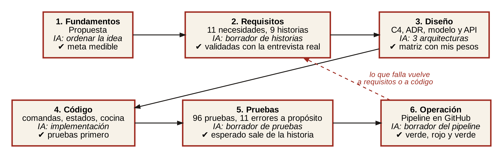

# Informe final del proyecto integrador

Proyecto: A-Fénix, plataforma de comandas digitales para el restaurante chino A Fénix de Oro\
Estudiante: Eduardo Ascencio · Ingeniería de Software · Fundación Escuela Tecnológica de Neiva - FET\
Repositorio: https://github.com/Darkandligh/Seminario\
Video de la sustentación: [PEGA AQUÍ EL ENLACE DE TU VIDEO]\
Fecha: 2026-11-26

## 1. Resumen

En A Fénix de Oro los pedidos viajan en papel: el mesero anota el pedido, lo escribe con marcador en la caja y la lleva a la cocina, y cuando un pedido sale suena una campana que no dice cuál es. Por eso hay pedidos que nunca se hacen y platos que salen distintos a lo que pidió el cliente. A-Fénix reemplaza el papel: el mesero registra el pedido en una tablet y la cocina lo ve en una pantalla en orden de llegada y marca cuándo está listo. Usé IA en las seis fases del ciclo de vida, y en todas se equivocó en algo. El error más grande lo encontré al final, cuando cambié la entrevista simulada por una real: la IA había inventado cómo se piden los platos. Cambié esa historia, su código y sus pruebas al requisito real. Después evalué cada historia contra sus escenarios de aceptación: de 18 escenarios, 9 se cumplen, 3 en parte y 6 son de historias sin construir. El proyecto tiene 93 pruebas que pasan, con 100 % de cobertura de la lógica del negocio, y un pipeline que las corre en cada cambio.

## 2. Problema y usuario

En el restaurante trabajan 4 meseros, 3 cocineros y 3 auxiliares de cocina, y hay 12 mesas. En la hora pico, de 12 a 3 de la tarde, salen unos 100 pedidos. El cliente pide el plato y el color, por ejemplo «un arroz con todas las carnes color café». El mesero lo anota, lo escribe con marcador en la caja del pedido y la lleva a la cocina diciéndolo en voz media. Los domicilios llegan por llamada y se anotan en un papel con el pedido, el color, la dirección, el barrio, el teléfono y el total. La cocina prepara en orden de llegada y, cuando un pedido sale, suena una campana; el mesero va por él, pero no siempre es el suyo y tiene que sacar pedidos hasta encontrarlo.

Los problemas más comunes son pedidos que nunca se hicieron, con clientes esperando 20 minutos, y pedidos o direcciones mal anotados «por falta de comunicación». El restaurante no tiene internet, y lo que más le preocupa de un sistema son las fallas y los congelamientos. Lo que necesitan es que todo pedido, de mesa o a domicilio, llegue completo a la cocina y que se sepa cuál está listo.

Evidencia: [propuesta del módulo 1](docs/modulos/S2_Propuesta.pdf) y [documento de requisitos con la entrevista](docs/modulos/S3_Requisitos.pdf), anexo A. Las respuestas son mías, como cajero del restaurante; lo explico en la sección 6.

## 3. La IA en el ciclo de vida

Seguí el ciclo de vida completo, una fase por módulo del seminario, y en cada fase la IA hizo una parte y yo la revisé. Cuando algo fallaba en las pruebas o en el pipeline, volvía a la fase de requisitos o a la de código, no a cambiar la prueba.

| Módulo y fase | Qué hice con IA | Herramienta | Evidencia | Cómo verifiqué |
|---|---|---|---|---|
| 1. Fundamentos | Ordenar la propuesta: problema, fase donde aplicar IA (pruebas) y meta medible | Claude (chat) | [S2_Propuesta.pdf](docs/modulos/S2_Propuesta.pdf) | La idea y la meta son mías; revisé que la meta se pudiera medir (cobertura y errores a propósito) |
| 2. Requisitos | Pasar las respuestas a necesidades con cita, historias con escenarios Gherkin, RNF y trazabilidad; al final, comparar la entrevista simulada con la real | Claude (chat) | [S3_Requisitos.pdf](docs/modulos/S3_Requisitos.pdf) | Cada necesidad tiene su cita. Con la entrevista real cambié la HU-02 y agregué la HU-09 |
| 3. Diseño | Tres alternativas de arquitectura, diagramas C4, modelo de datos y API, y una revisión de coherencia | Claude (chat) | [S4_Diseno.pdf](docs/modulos/S4_Diseno.pdf) | Matriz ponderada con mis pesos; cada caja, entidad y ruta contra una historia (5 fichas de prompt) |
| 4. Código | `registrar_comanda` con pruebas primero (rojo, verde, refactor). Revisión de seguridad con ruff, bandit, mypy, pip-audit y dos revisiones con IA | Claude (chat) y Claude Code en VS Code (agente) | [README](README.md), [revision_seguridad.md](revision_seguridad.md) | 22 pruebas escritas antes del código; 17 pruebas de abuso en rojo antes de corregir; diff del agente revisado |
| 5. Pruebas | Tabla de casos con particiones, límites y tabla de decisión; borrador de pruebas de la IA revisado; datos sintéticos; 11 errores metidos a propósito; reporte de defecto | Claude Code en VS Code | [registro_pruebas.md](registro_pruebas.md), [evidencias/semana-7](evidencias/semana-7), [D-01](docs/defectos/D-01.md) | Cada esperado sale de una historia, no del código. Corrí el borrador de la IA contra los 11 errores |
| 6. Operación | Pipeline de GitHub Actions generado con IA y revisado con la lista de revisión de pipelines del curso | Claude (chat) | [ci.yml](.github/workflows/ci.yml), [revision_configuracion.md](docs/revision_configuracion.md) | Ejecución en verde, error a propósito en rojo y otra vez en verde |

Todas las decisiones con IA están en la [bitácora](bitacora_ia.md): 26 entradas, 15 aceptadas, 7 aceptadas con cambios y 4 rechazadas.

## 4. Verificación: lo que la IA hizo mal y cómo lo encontré

### Caso 1: requisitos que el restaurante nunca dijo

Este fue el error más grande y lo encontré tarde. Cuando pasé el proyecto de VetCare Pro a A-Fénix no tenía una entrevista con el restaurante, y la IA adaptó las respuestas de otra entrevista simulada. De ahí salió la HU-02: el mesero elige la base, la proteína, el tamaño y el picante de cada plato. Con eso se construyó la carta de ejemplo, la validación de `registrar_comanda` y 22 pruebas. Al final del seminario respondí yo mismo el cuestionario, como cajero del restaurante, y la respuesta fue otra: el cliente solo dice el plato y el color, «dame un chop suey café». La entrevista simulada también había inventado los números de personal y de pedidos y había dejado por fuera los domicilios, que el restaurante pone entre las tres cosas más importantes. Lo detecté comparando cada historia con las respuestas reales. Pasé la HU-02 a «plato y color» y agregué la HU-09 de domicilios. Luego cambié el código en tres commits: primero las pruebas de aceptación nuevas en rojo ([760f3dd](https://github.com/Darkandligh/Seminario/commit/760f3dd)), después las pruebas viejas adaptadas al requisito real, en un commit aparte que explica que cambió el requisito y no el código ([18e81e4](https://github.com/Darkandligh/Seminario/commit/18e81e4)), y al final la carta y la validación ([131d7be](https://github.com/Darkandligh/Seminario/commit/131d7be)) ([requisitos v3](docs/modulos/S3_Requisitos.pdf), sección 7, y la [versión 2 con la entrevista simulada](docs/modulos/S3_Requisitos_v2_entrevista_simulada.pdf)). Algo parecido ya me había pasado en la semana 3 con VetCare Pro, cuando la IA armó requisitos de inventario, recepcionista y facturación antes de la entrevista.

### Caso 2: un tope de seguridad que no protegía nada

Este fue en el código. En la revisión de seguridad el agente puso un tope de 50 platos por comanda (H-03), pero contaba las filas de la lista y no los platos. Como cada fila tiene su cantidad, 50 filas de cantidad 20 eran 1000 platos, y el tope se saltaba repartiendo los platos en filas. Lo encontré en la segunda revisión, con el prompt de la semana que pide separar los problemas seguros de las sospechas y comprobar cada uno llamando la función: con 3 filas de 20 la comanda quedó registrada con 60 platos. Primero escribí la prueba de abuso en rojo ([3556eef](https://github.com/Darkandligh/Seminario/commit/3556eef)) y después la corrección, que suma las cantidades ([affc4b8](https://github.com/Darkandligh/Seminario/commit/affc4b8)). Quedó como H-05 en el informe de seguridad y como el defecto [D-01](docs/defectos/D-01.md).

### Caso 3: pruebas que pasaban aunque el código estuviera mal

En la fase de pruebas le pedí a la IA un borrador para el cambio de estado y la pantalla de cocina. Para revisar el orden de la pantalla usó `assert len(resultado) == 3`, para la hora de entrega `assert c.hora_listo is not None`, y además escribió una prueba de que un «admin» puede cambiar el estado. Las dos primeras pasan aunque el orden esté al revés o la hora sea cualquiera, y la tercera es una regla inventada, porque A-Fénix no tiene administrador y HU-07 dice que solo la cocina cambia el estado. La del admin falló, revisé HU-07 antes de tocar el código y vi que el error estaba en la prueba. Para encontrar las pruebas débiles metí 11 errores a propósito en el código, y el borrador no habría detectado 7. Descarté o corregí 11 pruebas del borrador y agregué las que faltaban. Mi suite atrapó 10 de los 11 errores, y el que se escapó, una modificación vacía marcada como «fuera de carta», me llevó a agregar una prueba que revisa el tipo exacto de la excepción ([registro_pruebas.md](registro_pruebas.md), commit [911442f](https://github.com/Darkandligh/Seminario/commit/911442f)).

### Caso 4: un pipeline que parecía bien

En operación le pedí a la IA un pipeline con un prompt simple. Me dio uno que corre `pytest` en cada push a `main`, con Python «3.x» y `pip install pytest` sin versión ([borrador](evidencias/entrega-final/ci_borrador_ia.yml)). Funcionaba, pero no revisaba las ramas de cada semana, que es donde trabajo, no limitaba los permisos, usaba versiones que cambian solas y solo corría las pruebas. actionlint no marcó nada porque el archivo es válido; los problemas los vi revisándolo línea por línea con la lista de revisión de pipelines del curso. Corregí los seis ([revision_configuracion.md](docs/revision_configuracion.md)) y comprobé que con un error a propósito el pipeline se pone en rojo.

## 5. Estado final del sistema

La arquitectura es un monolito web en Python con FastAPI y SQLite, instalado en un mini PC del restaurante, que no depende de internet y tiene la pantalla de cocina conectada por cable. Ganó la matriz ponderada con 103 puntos, contra 69 de la opción en la nube y 65 de los microservicios ([documento de diseño y ADR-001](docs/modulos/S4_Diseno.pdf)).

De las 9 historias de la versión 3 hay lógica construida para 6. Registrar el pedido (HU-01) y la validación del plato y su color (HU-02) están en `afenix/comandas.py`. La pantalla de cocina en orden de llegada (HU-04) y el tiempo de espera (HU-05) están en `afenix/cocina.py`. El cambio de estado paso a paso (HU-06) y la regla de que solo la cocina lo cambia (HU-07) están en `afenix/estados.py`. Faltan HU-03, que el pedido llegue solo a la cocina, porque necesita la API; HU-08, la consulta por mesa, y HU-09, los domicilios.

### Evaluación de las historias de usuario

Para evaluar las historias escribí una prueba por cada escenario de aceptación del documento de requisitos, con los mismos datos del escenario ([tests/test_aceptacion.py](tests/test_aceptacion.py)). Cada prueba comprueba todo el «entonces» del escenario. Cuando el código no cumple el criterio, la prueba queda marcada como diferencia conocida (`xfail`) en lugar de cambiarla para que pase. Los criterios son los de la versión 3, que sale de la entrevista real.

| Historia | Prioridad | Escenario | Resultado | Qué encontré |
|---|---|---|---|---|
| HU-01 Registrar el pedido | Must | 1. Pedido registrado | Cumple | Queda «recibido» con mesa, platos y hora |
| | | 2. Pedido sin platos | Cumple | Mismo mensaje del criterio |
| HU-02 Plato y color | Must | 1. Plato con color | Cumple | Queda el chop suey con color café |
| | | 2. Color que no existe | Cumple | «El color no está en la carta» |
| HU-03 Llega a la cocina | Must | 1 y 2 | Sin construir | Necesita la API y la red local |
| HU-04 Cocina en orden de llegada | Must | 1. Orden por llegada | Cumple | La mesa 6 sale antes que la 2 |
| | | 2. Pedido listo | Cumple | No aparece en la pantalla |
| HU-09 Domicilios | Must | 1 y 2 | Sin construir | Historia nueva de la entrevista real |
| HU-05 Tiempo de espera | Should | 1. Tiempo a la vista | Cumple | 12 minutos |
| | | 2. Hora del equipo errada | En parte | No muestra un tiempo negativo, pero el mensaje no es el del criterio |
| HU-06 Cambio de estado | Should | 1. Pedido listo | Cumple | Guarda las 12:24 como hora de entrega |
| | | 2. Salto o devolución | En parte | No cambia el estado, pero el mensaje no es el del criterio |
| HU-07 Solo la cocina cambia el estado | Should | 1. Cambio desde la cocina | En parte | No guarda quién lo hizo ni a qué hora |
| | | 2. Cambio desde el salón | Cumple | Lo rechaza y el estado no cambia |
| HU-08 Consulta por mesa | Could | 1 y 2 | Sin construir | Pendiente |

De los 18 escenarios, 9 se cumplen, 3 en parte y 6 son de historias sin construir. De las cinco historias Must, tres están completas (HU-01, HU-02 y HU-04) y dos sin construir (HU-03 y HU-09). La HU-02 se cumple después de cambiarla al requisito real; antes de la entrevista real sus pruebas también pasaban, pero sobre un requisito que el restaurante no usa. Las diferencias de HU-05, HU-06 y HU-07 no las había visto antes, porque las pruebas de la semana 7 revisaban que hubiera un error pero no comparaban el mensaje con el del criterio. La entrevista real sí confirmó varias reglas del código: la cocina trabaja en orden de llegada, un pedido enviado no se devuelve ni se cancela, y el restaurante tiene 12 mesas, que ya quedó como tope en el código ([d07ecaa](https://github.com/Darkandligh/Seminario/commit/d07ecaa) y [b3395a8](https://github.com/Darkandligh/Seminario/commit/b3395a8)).

Hay 93 pruebas que pasan, entre normales, de límite, de error, de abuso y de aceptación, con 100 % de cobertura de `afenix/`, y 3 pruebas de aceptación marcadas como diferencias conocidas. El pipeline las corre junto con ruff, mypy, bandit y pip-audit en cada cambio ([última ejecución del pipeline en main](https://github.com/Darkandligh/Seminario/actions?query=branch%3Amain)).

No alcancé a hacer la API, la base de datos ni las pantallas. El seminario se centró en la lógica y en cómo verificarla. Lo que más pesa ahora es construir los domicilios (HU-09) y corregir las tres diferencias de la evaluación. También quedan preguntas: desde cuántos minutos un pedido está demorado (P-02), porque depende del plato, y qué colores tiene la carta (P-04).

## 6. Reflexión ética y legal

| Principio | Decisión en mi proyecto | Evidencia |
|---|---|---|
| Datos personales (Ley 1581 de 2012) | No uso datos de personas reales. Las comandas solo tienen mesa, platos y hora; los datos de prueba son sintéticos y los nombres del documento de requisitos son ficticios. A la IA nunca le pasé datos del restaurante | [tests/conftest.py](tests/conftest.py), [S3, introducción](docs/modulos/S3_Requisitos.pdf) |
| Sesgo | La IA tiende a proponer lo que ve en otros sistemas (modificaciones por plato, administradores, facturación, microservicios) aunque el restaurante no lo use. Además, quien respondió la entrevista soy yo, que también desarrollo el sistema. Para los dos casos la regla fue la misma: nada entra sin una cita, y si la cita contradice el diseño, cambia el diseño | Casos 1 y 3 de este informe |
| Transparencia | Declaro en la bitácora cada uso de IA y guardo los borradores de la IA sin cambios. Dejé en el repositorio la versión 2 de los requisitos, con la entrevista simulada, al lado de la versión 3 con la real, para que se vea qué cambió | [bitacora_ia.md](bitacora_ia.md), [evidencias/](evidencias) |
| Responsabilidad | Lo que entrego es mío aunque lo haya escrito la IA. Por eso ninguna prueba se modifica para que pase, el agente trabaja en una rama aparte y reviso su diff, y el pipeline no deja pasar un cambio que rompa las pruebas | Entrada 16 de la bitácora, [ci.yml](.github/workflows/ci.yml) |
| Propiedad intelectual y política de uso | Las dependencias son de código abierto (pytest, ruff y mypy con licencia MIT; bandit y pip-audit con Apache 2.0). La política de uso de Claude permite usar lo que genera, y lo declaro. Usé el repositorio de un compañero solo como referencia del formato de entrega, sin copiar su código | [requirements-dev.txt](requirements-dev.txt), [README, sección 8](README.md) |

El dilema más importante fue la entrevista, y tuvo dos momentos. Primero, cuando cambié el proyecto a A-Fénix, la IA adaptó las respuestas de una entrevista que había hecho para otro proyecto. Las usé, pero no podía presentarlas como si fueran del restaurante, así que las marqué como simuladas. Después, para tener datos reales, respondí yo mismo el cuestionario, porque trabajo como cajero en el restaurante. Eso me da datos de primera mano, pero me pone en los dos lados: soy el que informa y el que desarrolla, y podía inclinar las respuestas hacia lo que ya había construido. Lo resolví respondiendo un cuestionario escrito, copiando las respuestas tal cual y cambiando el diseño cuando las respuestas lo contradecían, aunque eso obligara a cambiar una historia Must con su código y sus pruebas. Lo dejé declarado en el documento de requisitos.

## 7. Aprendizajes

Ahora sé escribir el contrato y las pruebas antes de pedirle código a la IA, y eso me obliga a decidir qué tiene que hacer la función antes de verla. También aprendí que una prueba en verde no prueba nada por sí sola: hay que meter errores a propósito para saber si la prueba los ve. Donde más confié de más en la IA fue en los requisitos. Construí una historia completa, con su código y sus pruebas, sobre una forma de pedir los platos que el restaurante no usa, y todo estaba en verde. Las pruebas comprobaban que el código hacía lo que decía la historia, pero nadie había comprobado que la historia fuera cierta. Lo que haría distinto es hacer la entrevista real desde el comienzo, antes de escribir una sola historia, y pedirle a la IA una sola cosa a la vez.

## 8. Anexos

Todo está en el repositorio. La bitácora de uso de IA está en [bitacora_ia.md](bitacora_ia.md). Los documentos de los módulos 1 a 3 están en [docs/modulos](docs/modulos): la [propuesta](docs/modulos/S2_Propuesta.pdf), los [requisitos con la entrevista real](docs/modulos/S3_Requisitos.pdf) (y la [versión con la entrevista simulada](docs/modulos/S3_Requisitos_v2_entrevista_simulada.pdf)) y el [diseño con los diagramas C4, el ADR, el modelo y la API](docs/modulos/S4_Diseno.pdf). El código y la revisión de seguridad del módulo 4 están en el [README](README.md) y en [revision_seguridad.md](revision_seguridad.md). Las pruebas del módulo 5 están en [registro_pruebas.md](registro_pruebas.md), con sus evidencias en [evidencias/semana-7](evidencias/semana-7) y el reporte de defecto [D-01](docs/defectos/D-01.md). El pipeline del módulo 6 está en [ci.yml](.github/workflows/ci.yml) y su revisión en [revision_configuracion.md](docs/revision_configuracion.md). Cada semana se trabajó en su rama (`semana-5`, `semana-6`, `semana-7` y `entrega-final`) y todas quedaron unidas en `main`.
